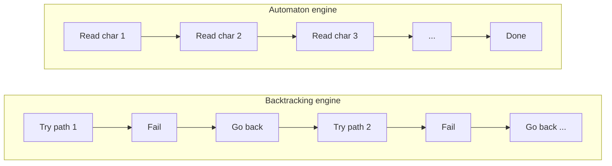

# When Regular Expressions Go Wrong: The Hidden Danger of Backtracking

**Author:** Shreya Pawar
**Subject:** Automata Theory and Compiler Design (Self-Learning Article)
**Topic:** Regular expressions, finite automata, and catastrophic backtracking

---

## Table of Contents

- [Introduction](#introduction)
- [Two Ways to Run the Same Pattern](#two-ways-to-run-the-same-pattern)
- [A Small Pattern with a Big Problem](#a-small-pattern-with-a-big-problem)
- [What Happened at Cloudflare](#what-happened-at-cloudflare)
- [How to Protect Your Code](#how-to-protect-your-code)
- [Why This Matters for Computer Science](#why-this-matters-for-computer-science)
- [Conclusion](#conclusion)

---

## Introduction

On 2 July 2019, a large part of the internet slowed to a crawl. Websites behind Cloudflare, one of the world's biggest web infrastructure companies, started returning errors for about half an hour. The cause was not a cyberattack or a hardware failure. It was a single regular expression in a security rule that made servers burn through their processing power.

When I first read this, I was struck that a few characters of pattern matching could cause such a failure. The explanation lies in Automata Theory, and it is a good lesson in why theory matters in real software.

## Two Ways to Run the Same Pattern

Every regular expression describes a regular language, and in theory every regular language can be recognized by a finite automaton. The important question is how a regex engine actually runs the pattern. There are two main approaches.

The first is the **automaton approach**, used by tools like `grep` and by Google's RE2 library. The pattern is converted into an NFA or DFA, and the input is read once from left to right. The engine keeps track of every state it could currently be in, so it never needs to go back. The running time grows in direct proportion to the length of the text, which is called linear time.

The second is the **backtracking approach**, used by the regex engines in many popular languages such as Python, Java, JavaScript, and Perl. The engine tries one path through the pattern, and if it fails, it goes back and tries another. This makes it easy to support extra features like backreferences, but it comes with a hidden risk. In the worst case, the number of paths to try can explode.

| Feature | Automaton (NFA/DFA) engines | Backtracking engines |
|---|---|---|
| Examples | `grep`, RE2, Rust `regex` | Python `re`, Java, JavaScript, Perl |
| Worst-case time | Linear, O(n) | Can be exponential, O(2^n) |
| Backreferences | Not supported | Supported |
| Predictability | High | Depends on the pattern |

## A Small Pattern with a Big Problem

Consider this innocent-looking pattern:

```regex
(a+)+b
```

It means "one or more groups of a's, followed by a b". Now give it this input, a long run of a's that ends with a "c" instead of a "b":

```
aaaaaaaaaaaaaaaaaaaaaaaac
```

The match is certain to fail, but a backtracking engine does not know that yet.

The problem is that there are many ways to split a run of a's into groups. Four a's could be matched as one group of four, or as 3+1, 2+2, 1+3, 2+1+1, and so on. When the final "b" is missing, the engine tries every possible split before giving up. For a string of n a's, there are about 2^n ways to split it, so each extra "a" doubles the work. With 25 characters that is over 33 million attempts, and with 40 characters it becomes practically impossible to finish.

This is called **catastrophic backtracking**, and an attacker who exploits it deliberately is performing a **ReDoS (Regular Expression Denial of Service)** attack.

A simple picture of the difference:



In plain text:

```
Backtracking engine:   try path 1 -> fail -> go back -> try path 2 -> fail -> go back ...
                       (work doubles with every extra character)

Automaton engine:      read char 1 -> read char 2 -> read char 3 -> ... -> done
                       (work grows one step per character)
```

### Try it yourself

You can see the effect on your own machine with this short Python script. Increase `n` slowly, since the time roughly doubles with each step.

```python
import re
import time

pattern = re.compile(r"(a+)+b")

for n in range(18, 27):
    text = "a" * n + "c"
    start = time.time()
    pattern.match(text)
    print(f"n = {n}: {time.time() - start:.3f} seconds")
```

## What Happened at Cloudflare

Cloudflare engineers deployed a new rule in their web application firewall, which inspects incoming traffic for malicious content. One regular expression in that rule contained a pattern that could backtrack heavily on certain inputs. Once the rule went live across their global network, the CPU on their servers hit 100% and traffic could not be processed.

After the problem was found, the rule was switched off and service returned to normal. Cloudflare later published a detailed post-mortem and moved to a regex engine that guarantees linear-time matching, the same automaton-based approach described above.

## How to Protect Your Code

Understanding automata gives us practical ways to avoid this problem. The strongest fix is to use an engine that guarantees linear time, such as RE2 or Rust's `regex` crate, which are built on NFA and DFA simulation. These engines give up a few features, like backreferences, in return for safety.

If you must use a backtracking engine, there are good habits to follow:

- Avoid nested quantifiers like `(a+)+` or `(a*)*`.
- Avoid overlapping alternations, such as `(a|aa)+`.
- Limit the length of any input that a regex will process.
- Set a timeout so a single bad match cannot freeze the whole program.
- Test your patterns with deliberately hostile inputs, and use free tools that scan regexes for ReDoS vulnerabilities.

## Why This Matters for Computer Science

This story shows that the gap between a mathematical model and a practical implementation is not just academic. Kleene's theorem tells us that regular expressions and finite automata are equivalent, but equivalent in power does not mean equivalent in performance. A DFA never revisits a character, while a backtracking engine can, and that difference separated a smooth day from a global outage.

It also reminds us why compiler design and automata theory are worth learning properly. The lexical analyzers inside compilers are built from the same machinery, and they use DFAs precisely because they promise predictable, linear-time scanning. A compiler that took exponential time to tokenize a source file would be useless, so the theory is what makes the tool trustworthy.

Finally, the lesson applies well beyond regex. Whenever we use a powerful tool, it helps to know what is happening underneath. Knowing the model lets us predict how code will behave on inputs we have never tried, including malicious ones.

## Conclusion

Regular expressions look small, but they carry the full weight of automata theory behind them. Used with an understanding of NFAs, DFAs, and backtracking, they are fast, safe, and elegant. Used carelessly, they can bring down servers serving millions of people. For students of Automata and Compiler Design, the takeaway is clear: theory is not separate from practice, it is what lets us build software we can rely on.

---

**Tags:** `#Automata` `#CompilerDesign` `#RegularExpressions` `#CyberSecurity` `#ComputerScience`
